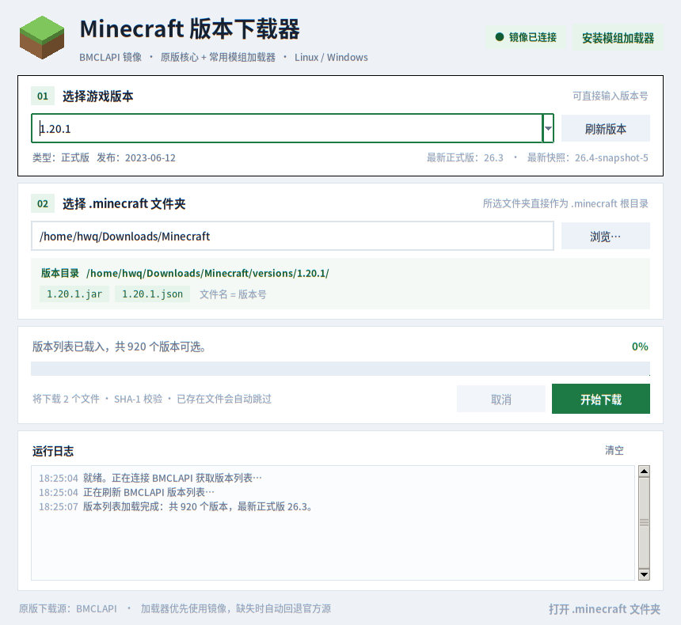
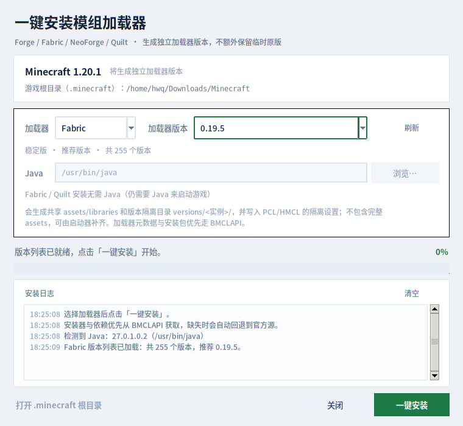

# MC 版本下载器

[](LICENSE)

一个只用 Python 标准库编写的 Minecraft 下载与模组加载器安装小工具。支持从 **BMCLAPI** 下载客户端核心文件，并一键安装 **Fabric / Forge / NeoForge / Quilt**。

适用于 **Windows / Linux / macOS**，提供图形界面和命令行两种使用方式。





> PCL / HMCL 的目录结构、版本隔离和独立加载器版本的依据见 [LAUNCHER_STRUCTURE.md](LAUNCHER_STRUCTURE.md)。

## 重要：你选择的文件夹就是 `.minecraft`

- 你选择的文件夹**本身就是 `.minecraft` 根目录**，工具不会在它下面再套一层 `<版本号>/`。
- 版本文件只放进 `versions/<版本 ID>/`，不会把 `<版本>.jar`、`<版本>.json` 丢在 `.minecraft` 根目录。
- 安装带模组加载器的版本时：
  - 工具把原版 JSON 合并进加载器 JSON，并把原版 JAR 复制到加载器目录；
  - 加载器版本变成**独立版本**，不再需要额外的原版版本；
  - 如果安装前该目录本来没有原版版本，安装完成后 `versions/` 中只会留下加载器版本。
- 如果安装前已经有原版版本，工具会保留它（避免误删已有存档/配置）；加载器版本本身仍是独立的，不依赖它。
- 文件夹名字不必叫 `.minecraft`；你选中的路径会被直接当作 `.minecraft` 根目录，只要结构正确，PCL / HMCL 可以添加这个路径。

## 核心特性

### 原版文件下载

- 下载 Minecraft 客户端核心 `<版本>.jar` 和版本元数据 `<版本>.json`
- 直接放进所选 `.minecraft` 的 `versions/<版本>/`：
  ```
  你选择的 .minecraft/
  ├── assets/
  ├── libraries/
  └── versions/
      └── 1.20.1/
          ├── 1.20.1.jar
          └── 1.20.1.json
  ```
- 下载完成后用 SHA-1 校验文件完整性
- 已存在且校验通过的文件自动跳过
- 网络失败自动重试，支持取消下载
- 兼容带空格等特殊字符的旧版本号（例如 `1.14.2 Pre-Release 4`）

### 一键安装模组加载器

- 支持 **Fabric**、**Forge**、**NeoForge**、**Quilt**
- 自动查询当前 Minecraft 版本可用的加载器版本，并默认选择推荐的稳定版本
- Fabric / Quilt 直接生成启动配置和依赖，不需要运行安装器
- Forge / NeoForge 自动下载官方安装器并静默执行
- NeoForge 安装器会自动改用 BMCLAPI 镜像地址，解决 `maven.neoforged.net` 访问困难
- 加载器版本合并为**独立版本**：原版 JAR 复制到加载器目录，原版 JSON 合并进加载器 JSON，删除 `inheritsFrom`
- 按 PCL / HMCL 的**版本隔离**约定，把 `mods/`、`saves/` 等游戏数据放入 `versions/<加载器实例>/`
- 自动写入 PCL 与 HMCL 的实例隔离设置，导入启动器后直接使用隔离目录
- 自动检测 Java；Forge / NeoForge 也可以在界面中选择 `java` / `java.exe`
- 安装器完整输出保存到 `.minecraft/.mcdown/installers/`，不污染版本目录

## 下载 Windows EXE

无需安装 Python，直接下载最新发行版：

**https://github.com/HWQ277/mcdown/releases/latest**

发行版中的 `MCDown.exe` 是单文件 Windows 程序，双击即可打开图形界面。该文件未做代码签名，Windows SmartScreen 可能提示“未知发布者”；此时请核对 SHA-256 校验值后选择“仍要运行”。

## 环境要求

- Python 3.8 或更高版本
- 图形界面需要 Tkinter（Windows 官方 Python 安装包默认自带）
- 能访问 `bmclapi2.bangbang93.com`
- 安装 Forge / NeoForge 需要本机已安装 Java（建议 Java 17 或更高）
- 安装 Fabric / Quilt 本身不需要 Java，但启动 Minecraft 仍需要对应版本的 Java

Linux 如果提示缺少 Tkinter：

```bash
sudo apt install python3-tk        # Debian / Ubuntu
sudo dnf install python3-tkinter   # Fedora
```

## 图形界面使用

Windows，在项目目录中执行：

```bat
python mcdown.py
```

也可以直接双击 `start_windows.bat`。

Linux / macOS：

```bash
python3 mcdown.py
```

### 下载原版

1. 在「选择游戏版本」中选择版本，或直接输入版本号。
2. 在「选择 .minecraft 文件夹」中选择文件夹。**这个文件夹会直接作为 `.minecraft` 根目录**。
3. 点击「开始下载」。
4. 文件会保存到 `<所选文件夹>/versions/<版本>/`。

### 安装模组加载器

1. 先选好 Minecraft 版本和 `.minecraft` 文件夹。
2. 点击窗口右上角「安装模组加载器」。
3. 选择加载器（Fabric / Forge / NeoForge / Quilt）。
4. 选择加载器版本；程序会默认选中推荐稳定版。
5. 点击「一键安装」。

如果是 Forge / NeoForge，安装前请确认 Java 已自动检测成功；如果没有检测到，点击「浏览…」选择 `java` 或 `java.exe`。

安装完成后，窗口会显示 `.minecraft` 根目录、版本隔离目录和启动配置。可点击「打开 .minecraft 根目录」查看生成的文件。

### 版本隔离说明

PCL 和 HMCL 都使用标准结构：`assets/`、`libraries/` 由根目录共享；开启版本隔离后，游戏数据放到 `versions/<实例>/`。本工具会：

- 把加载器实例的 `mods/`、`saves/`、`resourcepacks/`、`shaderpacks/`、`config/`、`logs/` 创建在 `versions/<实例>/` 下；
- 在 `versions/<实例>/PCL/Setup.ini` 写入 PCL 的 `VersionArgumentIndieV2:True`；
- 在 `versions/<实例>/.hmcl/config/instance-game-settings.json` 写入 HMCL 的空 `runningDirectory` 隔离覆盖。

详细依据和源码链接见 [LAUNCHER_STRUCTURE.md](LAUNCHER_STRUCTURE.md)。

## 安装后的目录结构

### 只下载原版

```text
你选择的 .minecraft/
├── assets/
│   ├── indexes/
│   ├── objects/
│   └── log_configs/
├── libraries/
└── versions/
    └── 1.20.1/
        ├── 1.20.1.jar
        └── 1.20.1.json
```

### 安装加载器

```text
你选择的 .minecraft/
├── assets/
│   ├── indexes/
│   ├── objects/
│   └── log_configs/
├── libraries/
├── versions/
│   └── fabric-loader-0.19.5-1.20.1/
│       ├── fabric-loader-0.19.5-1.20.1.json   # 已合并原版信息，无 inheritsFrom
│       ├── fabric-loader-0.19.5-1.20.1.jar    # 原版客户端 JAR 复制而来
│       ├── mods/
│       ├── saves/
│       ├── resourcepacks/
│       ├── shaderpacks/
│       ├── config/
│       ├── logs/
│       ├── PCL/Setup.ini
│       └── .hmcl/config/instance-game-settings.json
├── launcher_profiles.json
└── .mcdown/
    └── installers/                            # Forge/NeoForge 安装器与日志
```

新安装加载器时，不会再额外保留 `versions/1.20.1/`。加载器目录里的 JAR/JSON 已经是完整的独立版本；`assets/` 和 `libraries/` 仍然是启动器共享目录。

如果安装前 `versions/1.20.1/` 已经存在，工具会保留它；加载器版本不依赖它。若确定不需要旧的原版版本，可自行删除该目录。

## 导入 PCL / HMCL

1. 在启动器中将 `<你选择的文件夹>` 添加为游戏目录。**这个文件夹就是 `.minecraft` 本身**，不需要再找它下面的子文件夹。
2. 选择加载器版本（例如 `fabric-loader-0.19.5-1.20.1`、`1.20.1-forge-47.4.28`）。
3. 工具已为加载器实例写入 PCL 的 `PCL/Setup.ini` 和 HMCL 的 `.hmcl/config/instance-game-settings.json`，两边都会使用 `versions/<实例>/` 作为隔离后的游戏目录。
4. 不需要再选择单独的原版版本；加载器版本已经独立。

如果使用的是较旧、无法读取上述实例配置的启动器版本，请在启动器中手动开启“版本隔离/各实例独立”。

验证记录：已用 **HMCL 3.16.4** 实际扫描本工具生成的 Fabric / Forge / NeoForge / Quilt 独立版本目录，均只识别到一个加载器版本，且没有实例设置 schema 错误；PCL 部分按当前源码中的 `PathVersion`、`PathIndie`、`PCL/Setup.ini` 和 `McVersion` 逻辑核对。详细依据见 [LAUNCHER_STRUCTURE.md](LAUNCHER_STRUCTURE.md)。

## 命令行使用

### 下载原版

`--output` 是 `.minecraft` 根目录本身，而不是它的父目录。

```bash
# 下载到 ./Minecraft/.minecraft/versions/1.20.1/
python3 mcdown.py --version 1.20.1 --output ./Minecraft/.minecraft

# 下载最新正式版 / 最新快照
python3 mcdown.py --latest-release --output ./Minecraft/.minecraft
python3 mcdown.py --latest-snapshot --output ./Minecraft/.minecraft

# 查看 BMCLAPI 版本列表
python3 mcdown.py --list
python3 mcdown.py --list release
python3 mcdown.py --list snapshot
```

### 一键安装加载器

```bash
# 自动选择推荐的 Fabric 版本；最终只保留独立加载器版本
python3 mcdown.py --version 1.20.1 --loader fabric --output ./Minecraft/.minecraft

# 指定 Forge 版本；Java 默认自动检测
python3 mcdown.py --version 1.20.1 --loader forge --loader-version 47.4.28 --output ./Minecraft/.minecraft

# 安装 NeoForge / Quilt
python3 mcdown.py --version 1.20.1 --loader neoforge --output ./Minecraft/.minecraft
python3 mcdown.py --version 1.20.1 --loader quilt --output ./Minecraft/.minecraft

# 手动指定 Java 路径
python3 mcdown.py --version 1.20.1 --loader forge \
  --java "/usr/lib/jvm/java-17-openjdk/bin/java" --output ./Minecraft/.minecraft
```

Windows 上把 `python3` 换成 `python` 或 `py` 即可。

不指定 `--loader-version` 时，程序会使用该 Minecraft 版本下推荐的稳定加载器版本。图形界面支持从完整列表中选择。

### 参数

| 参数 | 说明 |
| --- | --- |
| `--gui` | 强制启动图形界面 |
| `--cli` | 使用命令行模式 |
| `--version 版本号` | 要下载的 Minecraft 版本 |
| `-o`, `--output 目录` | 所选文件夹直接作为 `.minecraft` 根目录 |
| `--loader {fabric,forge,neoforge,quilt}` | 下载原版并一键安装指定加载器 |
| `--loader-version 版本号` | 指定加载器版本；默认推荐稳定版 |
| `--java 路径` | Forge/NeoForge 使用的 Java 可执行文件 |
| `--latest-release` | 使用最新正式版 |
| `--latest-snapshot` | 使用最新快照 |
| `--list [类型]` | 列出全部版本，或按 `release` / `snapshot` / `old_beta` / `old_alpha` 筛选 |

未指定 `--output` 时，默认使用：

- Windows：`%USERPROFILE%\Downloads\Minecraft`
- Linux / macOS：`~/Downloads/Minecraft`

这个默认路径同样会被直接当作 `.minecraft` 根目录。

## 下载源与镜像策略

- Minecraft 版本清单、客户端 JAR、版本 JSON：**BMCLAPI**
- Fabric 版本列表、启动配置和依赖：优先 BMCLAPI 的 `fabric-meta` / `maven`，缺失时回退官方源
- Forge 版本列表、安装器：BMCLAPI，安装器下载失败时回退 Forge 官方 Maven
- NeoForge 版本列表、安装器和依赖：BMCLAPI；安装器内部的 Maven 地址会被改写到 BMCLAPI
- Quilt 版本列表：BMCLAPI 无对应版本查询时回退 Quilt 官方 Meta；依赖优先 BMCLAPI，缺失时回退官方 Maven

BMCLAPI 是镜像服务，部分文件请求可能会 302 重定向到官方 CDN；请求入口仍然是从 BMCLAPI 发起，这是正常行为。

## 校验方式

- 原版 JSON：按版本清单中的 SHA-1 校验
- 原版客户端：按版本 JSON 中的 SHA-1 和文件大小校验
- Fabric / Quilt 依赖：有 SHA-1 时校验，同时检查 JAR 结构
- Forge 安装器：按 Forge 元数据中的 SHA-1 校验
- NeoForge 安装器：BMCLAPI Maven 未提供校验值时，至少验证下载结果是有效 JAR
- 所有正式文件都先写入 `.part` 临时文件，再原子替换，避免留下半截文件
- 加载器安装完成后会自检独立版本 JSON、JAR、版本隔离目录和启动器隔离配置

## 注意事项

- 本工具只处理 **客户端**，不下载完整 assets 资源对象；PCL / HMCL 可以在启动前补全缺失资源。
- 原版 JSON 已合并到加载器 JSON，但原版 libraries 和 assets 仍然由共享的 `libraries/`、`assets/` 目录提供。
- 不包含 OptiFine、LiteLoader 等较早或非标准加载器。
- 安装 Mod 时，将 Mod 文件放到所选加载器实例的 `versions/<实例>/mods/` 文件夹（版本隔离后的游戏目录）。
- `.mcdown/` 是工具自己的安装缓存和日志目录，不属于游戏版本。
- 不要在没有关闭安装器或启动器的情况下删除正在写入的版本目录。
- Forge / NeoForge 安装器需要可用的 Java；安装失败时请先查看 `.mcdown/installers/` 下的日志。

## 打包为 Windows EXE

仓库内置 GitHub Actions 工作流 `.github/workflows/build-windows.yml`，在 `windows-latest` 上使用 PyInstaller 构建单文件 EXE，避免 Linux 交叉编译带来的兼容问题。EXE 会作为 Release 资产发布。

也可以在 Windows 本地构建：

```bat
py -m pip install pyinstaller
pyinstaller --noconfirm --onefile --windowed --name MCDown mcdown.py
```

生成的程序在 `dist\MCDown.exe`。

## 许可证

本项目使用 **GNU General Public License v3.0 only**（`GPL-3.0-only`）发布。

Copyright (C) 2026 HWQ277。完整许可证文本见 [LICENSE](LICENSE)，版权与仓库信息见 [NOTICE](NOTICE)。

项目仓库：[https://github.com/HWQ277/mcdown](https://github.com/HWQ277/mcdown)

## 常见问题

**无法启动图形界面 / 没有显示环境**

使用命令行模式，例如：

```bash
python3 mcdown.py --version 1.20.1 --output ./Minecraft/.minecraft
```

**提示未找到 Java**

安装 Java 17+，并确保 `java` 在 PATH 中；也可以在图形界面点击「浏览…」选择 `java.exe`，或命令行传入 `--java 路径`。

**加载器版本列表获取失败**

检查网络是否能访问 BMCLAPI；Forge / NeoForge 也可以稍后重试。图形界面中的「刷新」按钮会重新获取。

**提示 HTTP 429**

BMCLAPI 触发了频率限制，等待几十秒后重试即可。

**安装 Forge / NeoForge 失败**

查看 `.minecraft/.mcdown/installers/*-install.log`。常见原因是 Java 版本不匹配、网络无法下载安装器依赖，或目标目录没有写权限。

**证书或 TLS 错误**

检查系统时间、代理设置和系统 CA 证书；如果仍失败，可以换一个网络环境再试。

**图形界面中文显示异常**

安装一套中文字体（Linux 推荐 Noto Sans CJK），程序会自动选择可用字体。
